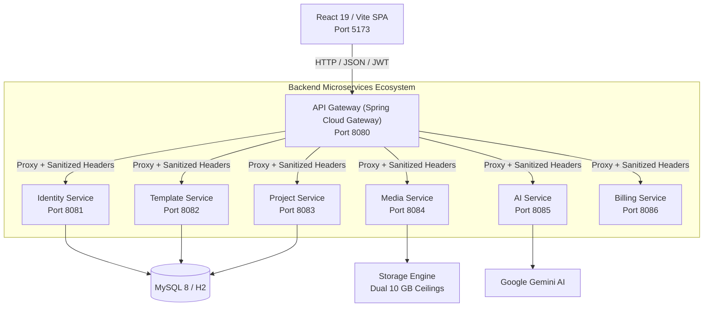
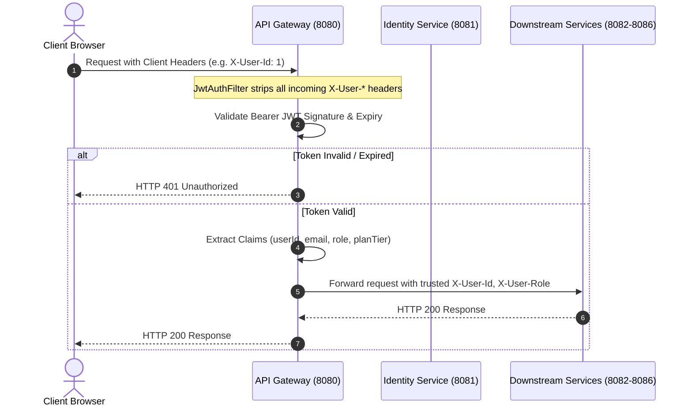
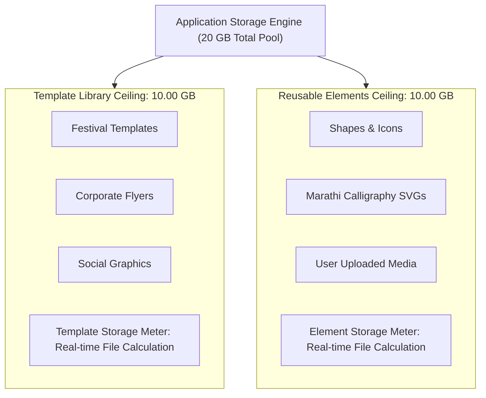

# Marathi Design Studio — System Architecture & Topology
**Technical Architecture Document** | **Version:** 2.0.0 | **Date:** October 24, 2026

---

## 1. System Overview

Marathi Design Studio is an enterprise cloud-based graphic design ecosystem modeled after modern web-native publishing platforms like Canva, tailored specifically for bilingual Marathi (Devanagari) and English typography and creative workflows.



---

## 2. Microservice Topology

| Service | Port | Technology | Primary Responsibilities | Data Store |
| :--- | :--- | :--- | :--- | :--- |
| **API Gateway** | 8080 | Spring Cloud Gateway | Path routing, JWT authentication, identity header sanitization, rate limiting, and CORS | Stateless |
| **Identity Service** | 8081 | Spring Boot 3.3, Spring Security | User registration, login, BCrypt hashing, JWT issuance, OAuth 2.0 social gateway | MySQL (`users`, `refresh_tokens`) |
| **Template Service** | 8082 | Spring Boot 3.3, Spring Data JPA | Seed catalog management (28+ authentic Marathi templates), categories, search indexing | MySQL (`templates`, `categories`) |
| **Project Service** | 8083 | Spring Boot 3.3, Spring Data JPA | Multi-page canvas JSON persistence, versioning, optimistic locking, and BOLA isolation | MySQL (`projects`, `project_versions`) |
| **Media Service** | 8084 | Spring Boot 3.3 | Image/audio asset ingestion, MIME validation, thumbnail generation, streaming | Local File System / S3 |
| **AI Service** | 8085 | Spring Boot 3.3 | Marathi copy generation, slogan synthesis, layout and typography recommendations | Gemini 1.5 Pro Hook |
| **Billing Service** | 8086 | Spring Boot 3.3 | 100% Free platform entitlement tracking, commercial print plugin hooks | MySQL (`subscriptions`) |

---

## 3. Security Architecture & Header Sanitization



### Key Security Safeguards
1. **Client Identity Header Sanitization:** The `JwtAuthFilter` explicitly removes all incoming `X-User-Id`, `X-User-Email`, `X-User-Role`, and `X-Plan-Tier` headers from untrusted HTTP clients before evaluating the JWT, preventing header-injection privilege escalation (resolves SEC-008).
2. **Fail-Closed Default Deny:** Routes outside `PUBLIC_PATH_PREFIXES` are rejected with HTTP 401 unless accompanied by a cryptographically verified JWT signature.
3. **Role-Based Access Control:** All `/api/v1/admin/**` paths are guarded at both the Gateway layer (requiring `ROLE_ADMIN`) and the frontend React router (`<AdminRoute>`).
4. **BOLA/IDOR Enforcement:** The Project Service checks that `project.userId == request.getHeader("X-User-Id")` on all retrieve, update, and delete queries, preventing cross-tenant data access (HTTP 403 Forbidden).

---

## 4. Multi-Page Document Architecture

To support complex slide decks, multi-page posters, and business presentations, the canvas engine utilizes a serialized document model that abstracts Fabric.js instances across multiple pages:

```json
{
  "version": "2.0",
  "documentTitle": "दिवाळी विशेष महोत्सव",
  "pageWidth": 1080,
  "pageHeight": 1080,
  "currentPageIndex": 0,
  "pages": [
    "{\"version\":\"5.3.0\",\"objects\":[{\"type\":\"text\",\"text\":\"शुभ दीपावली\"}]}",
    "{\"version\":\"5.3.0\",\"objects\":[{\"type\":\"rect\",\"fill\":\"#ff9933\"}]}"
  ],
  "pageTitles": [
    "Cover Page",
    "Event Schedule"
  ],
  "pageLocks": [
    false,
    false
  ]
}
```

### Document Engine Lifecycle:
1. **Active Page Swapping:** On page switch, the active Fabric.js canvas serializes to JSON string and stores in `pages[currentPageIndex]`. The target page's JSON string is then loaded into Fabric via `canvas.loadFromJSON()`.
2. **"Add Page Up":** Creates an empty canvas JSON object and splices it into `pages` at `currentPageIndex`, shifting all subsequent pages down.
3. **Lock Protection:** When a page is locked (`pageLocks[index] = true`), canvas objects receive `selectable = false` and `evented = false`, preventing accidental edits while preserving viewability.
4. **Unified PDF Compilation:** During PDF export, each page in `pages` is sequentially rendered to a temporary headless canvas, converted to a JPEG/PNG data stream, and appended as a new page in a unified jsPDF document.

---

## 5. Dual 10 GB Storage Architecture

As mandated by Product Rules 6 & 7, the platform maintains two strictly independent 10.00 GB storage quotas:



- **Pre-Upload Enforcement:** The Media Service calculates current library volume before accepting multipart uploads. If `currentVolume + uploadSize > 10,737,418,240 bytes` (10 GB), the upload is rejected immediately with HTTP 413 Payload Too Large.
- **SHA-256 Deduplication:** Assets are hashed via SHA-256 upon ingestion. Duplicate elements reference existing disk inodes, conserving storage quotas.
- **Garbage Collection:** Administrators can trigger "Run Safe Cleanup" from `/admin/storage`, which prunes orphaned temporary renders and soft-deleted assets older than 30 days.

---

## 6. Bilingual Typography Engine & 100+ Font Collection

Marathi typography requires specialized font-stack rendering to prevent Devanagari conjunct distortion (जोडाक्षरे). The studio integrates over 106 web-ready typefaces categorized into distinct cultural and practical design tiers:

1. **AMS Calligraphy Collection (India's Premier Poster Fonts):** AMS Aaditya, AMS Aakash, AMS Kiran, AMS Lekhani, AMS Manthan, AMS Sakal, AMS Saral, AMS Shree Lipi, AMS Vasudeva.
2. **Shivaji Classical Marathi Series:** Shivaji Unicode, Shivaji 01 Normal, Shivaji 01 Bold, Shivaji 05 Normal, Shivaji 05 Bold.
3. **Millennium Devanagari Series (12 Typefaces):** Millennium Ganesh, Mogara, Aditya, Ameya, Deepak, Gauri, Nilima, Pooja, Priya, Shailesh, Shridhar, Varun.
4. **Classic DTP Legends (Pankaj, Richa, Varsha, Saroj, Vimal, Ruchi):** 36 classic desktop-publishing typefaces covering wide, condensed, bold, italic, and thin cuts.
5. **Kruti Dev Heritage Collection:** Kruti Dev 010, 055, 080, 090, 100, 110, 120, 130, 140, 150, 255.
6. **Classic Marathi Heritage:** Priya, Roupya, Tirkas, Vakra, Mangal, Sakal, Lekhani, Kiran, Devanagari New.
7. **Modern Devanagari & Google Fonts:** Baloo 2, Tillana Calligraphy, Kalam Handwritten, Rozha One, Yatra One, Sarpanch, Ranga, Tiro Devanagari Marathi, Mukta, Noto Sans, Noto Serif.
8. **English & Latin Display:** Inter, Poppins, Roboto, Montserrat, Open Sans, Lato, Bebas Neue, Oswald, Playfair Display, Cinzel, Great Vibes, Pacifico, Caveat.

### Usability & Font Interaction Engine
- **CanvaFontSelector Dropdown:** Contextual toolbar popup with category filter pills, real-time search, star favorites, and live rendered Marathi glyph previews in that font's actual CSS face.
- **Text Drawer Typography Studio:** Live custom word previewer (`fontTesterText`) allowing users to type custom slogans (e.g. "श्री गणेश", "शुभ विवाह") and preview them across all 93 Marathi fonts simultaneously, with 1-click addition to the canvas artboard.
- **Font Loading Guard:** To guarantee zero font layout shifts during high-resolution rasterization, the export pipeline executes:
   ```javascript
   await document.fonts.ready;
   ```
   prior to invoking `canvas.toDataURL({ multiplier })`.

---

## 7. Product Rule 10 Alignment (Honest Integrations)

External integrations without production API keys adhere strictly to honest integration states:
- **No Fake Successes:** Buttons for unconfigured services (e.g. AI Image Generation, Razorpay Checkout, Unsplash Stock Photos) never claim successful completion.
- **Setup-Required Dialogs:** Clicking an unconfigured integration launches `IntegrationSetupModal`, displaying the service name, required environment variables, official documentation link, and step-by-step developer onboarding instructions.
