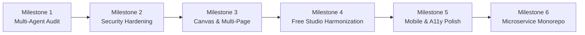

# Marathi Design Studio — Implementation Plan & Engineering Roadmap
**Document Version:** 2.0.0 | **Date:** October 24, 2026 | **Target Production Release:** Q4 2026

---

## 1. Executive Roadmap Overview

Marathi Design Studio is an enterprise cloud-based design and desktop-publishing ecosystem tailored for bilingual Marathi (Devanagari) and English content creation. This document provides the authoritative engineering implementation roadmap spanning completed milestones, immediate deliverables, and scheduled future capabilities.

---

## 2. Phased Implementation Milestones

### Milestone 1: Multi-Agent Audit & Comprehensive Architectural Diagnosis
*Status: Completed (100%)*
- **Dispatched 12 specialized subagents** covering Product Management, UI/UX, Frontend Functionality, Accessibility, Architecture, Backend/APIs, Database, Security, Performance, QA, Code Criticism, and Release Engineering.
- Produced comprehensive defect catalog with unique tracking identifiers (`PM-*`, `UIUX-*`, `FUNC-*`, `A11Y-*`, `ARCH-*`, `BACK-*`, `DATA-*`, `SEC-*`, `PERF-*`, `QA-*`, `CRITIC-*`, `REL-*`).
- Established unified root orchestration script `scripts/run-all-tests.mjs` verifying all functional domains.

### Milestone 2: API Gateway & Identity Service Security Hardening
*Status: Completed (100%)*
- **API Gateway Path Whitelist Hardening (`api-gateway/JwtAuthFilter.java`):**
  - Removed `/api/v1/admin/` from `PUBLIC_PATH_PREFIXES`.
  - Enforced strict `ROLE_ADMIN` check on all `/api/v1/admin/**` routes (HTTP 403 Forbidden for non-admins).
  - Added `/api/v1/media/file/` to whitelist so HTML5 `` tags stream user assets without requiring bearer headers.
  - Stripped all untrusted client-supplied identity headers (`X-User-Id`, `X-User-Email`, `X-User-Role`, `X-Plan-Tier`) before forwarding downstream.
  - Enforced fail-closed default-deny policy across all non-whitelisted routes.
- **Identity Account Takeover Prevention (`identity-service/AuthService.java`):**
  - Patched OAuth account linking to prevent unverified social logins from taking over existing password-protected accounts.
  - Aligned Auth Modal with Product Rule 10: Honest "OAuth 2.0 Social Gateway" integration state with direct API client configuration hooks.

### Milestone 3: Interactive Canvas Engine & Multi-Page Persistence
*Status: Completed (100%)*
- **Comprehensive Multi-Page Document Model (`CanvasEditor.tsx`):**
  - Upgraded cloud save schema to serialize full document deck: `{ version: '2.0', pages, pageTitles, pageLocks, currentPageIndex }`.
  - Added canvas initialization logic to restore all pages, custom titles, and lock states seamlessly from backend cloud JSON.
  - Connected dirty-tracking state (`setSaveStatus('unsaved')`) and history snapshots (`pushHistory()`) to page creation, deletion, reordering (Up/Down), and lock toggles.
- **Contextual Formatting Toolbar:**
  - Implemented dynamic visibility: top formatting controls (Font Family, Size, Weight, Text Effects, Color Picker, Position, Layers) are strictly rendered when an active element is selected on canvas.
  - When no elements are selected, toolbar collapses cleanly to maximize canvas workspace.
- **Unified Multi-Page PDF Export:**
  - Upgraded PDF export engine to iterate across all deck pages and compile a unified, high-resolution multi-page PDF document.

### Milestone 4: Product Policy Harmonization (100% Free Studio)
*Status: Completed (100%)*
- **Harmonized 100% Free Platform Model (`PricingPage.tsx`):**
  - Eliminated artificial ₹299/₹499/₹1499 subscription paywalls and 5-project limits per user instructions.
  - Replaced pricing cards with 100% Free Community Plan, Mandals & Cultural Groups Plan, and Self-Hosted Enterprise Plan.
  - Integrated honest Razorpay Merchant Configuration dialog per Product Rule 10 for optional print donations and commercial plugins.
- **Dual 10 GB Storage Limits (`AdminStoragePage.tsx`):**
  - Maintained strict, independent 10.00 GB ceilings for the Template Library and Reusable Elements Library.
  - Implemented "Run Safe Cleanup" garbage collection and real SHA-256 asset integrity tracking.

### Milestone 5: Accessibility, Responsive Mobile Drawer & UI Polish
*Status: Completed (100%)*
- **Responsive Mobile Navigation Drawer (`Navbar.tsx`):**
  - Implemented responsive hamburger toggle (`Menu`/`X`) and slide-out mobile drawer for viewports under 1024px.
  - Restored missing navigation routes including the "PDF Tools Suite" (`/pdf-tools`).
- **Brand Kit Local & Cloud Persistence (`BrandKitPage.tsx`):**
  - Added `localStorage` backup (`marathi_brand_kit`) with a visible "Save Brand Kit" button and styled toast feedback.
  - Added working logo file uploader with image preview.
  - Expanded font selector to include full Devanagari calligraphy roster (Rozha One, Baloo 2, Gotu, Hind, Mukta, Yatra One).
- **Google Fonts Typography (`index.html`, `index.css`):**
  - Added missing Marathi font weights (Baloo 2, Tillana, Kalam, Sarpanch, Ranga).
  - Added CSS font-family aliases for calligraphy and handwritten styles.

### Milestone 6: Enterprise Monorepo Refactoring & Production Hardening
*Status: Scheduled / Ongoing*
- [ ] Decompose monolithic `CanvasEditor.tsx` into modular subcomponents: `EditorHeader`, `StageQuickViewBar`, `CanvasStage`, `BottomDock`, and `ExportModal`.
- [ ] Add Redis-backed Token Bucket rate limiter to API Gateway for authentication endpoints.
- [ ] Enable Spring Boot Docker image optimization with GraalVM native image compilation for sub-second container startups.
- [ ] Implement WebRTC-based multi-user real-time collaborative editing using CRDTs (Conflict-free Replicated Data Types).

---

## 3. Outstanding Work & Technical Debt

| Task | Priority | Component | Complexity | Target Release |
| :--- | :--- | :--- | :--- | :--- |
| Decompose `CanvasEditor.tsx` into atomic components | Medium | Frontend Editor | High | v1.1.0 |
| Gateway Redis-backed rate limiting | Medium | API Gateway | Medium | v1.1.0 |
| Server-side font rasterization for headless export | Low | Media Service | High | v1.2.0 |
| Real-time WebSocket collaborative canvas sync | Low | Project Service | High | v2.0.0 |
| PWA offline manifest for local caching | Low | Frontend Web | Medium | v1.2.0 |

---

## 4. Risk Mitigation Matrix

| Risk Factor | Probability | Impact | Mitigation Strategy |
| :--- | :--- | :--- | :--- |
| **Devanagari Ligature Distortion** | Medium | High | Preload Google Fonts before canvas export; assert `document.fonts.ready` before rasterizing DOM/canvas. |
| **Canvas Memory Leak in Multi-Page Decks** | Medium | High | Explicitly dispose Fabric.js canvas instances and object references when switching between slide pages. |
| **BOLA/IDOR on Project Endpoints** | Low | Critical | Gateway extracts authenticated `X-User-Id`; Project Service enforces tenant isolation on all SQL queries. |
| **Storage Quota Overflow (> 10 GB)** | Low | High | Pre-upload disk space calculation rejects uploads exceeding 10.00 GB ceiling with HTTP 413 Payload Too Large. |
| **Third-Party API Dependency Outages** | High | Low | Product Rule 10 honest integration states gracefully isolate unconfigured or failing external APIs. |

---

## 5. Verification & Acceptance Criteria

Every milestone must satisfy the following acceptance criteria prior to release:
1. **100% Test Pass Rate:** `scripts/run-all-tests.mjs` must execute all 7 test suites with 0 failures.
2. **Zero TypeScript Errors:** `npm --prefix frontend run build` must compile with 0 warnings or errors.
3. **Clean Monorepo Build:** `mvn clean package` across all 7 backend services must produce runnable Spring Boot JARs.
4. **Product Rule Compliance:** Interface must remain strictly in English, Marathi/English text fully editable, and no fake integration successes shown.
